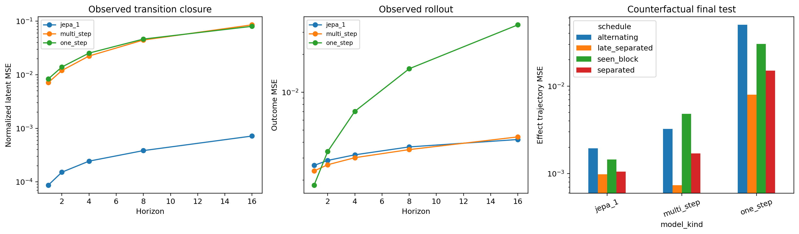

# Cambridge Research Task: Beyond Forecasting Toward Temporal Understanding

Can an accurate medical world model be trusted to simulate how treatment effects
emerge, accumulate, and decay? This repository provides a focused negative answer
and a small proof of concept for improving that capability.

## Central claim

Low factual prediction error does not certify that a world model has learned the
controlled temporal dynamics needed for intervention simulation. In a transparent
medical simulator, predictive training can (i) compress away history that modifies
treatment response and (ii), even when that information is decodable from the
latent state, fail to preserve and update it under multi-step action-conditioned
transitions. We treat accurate effect trajectories under unseen treatment schedules
as **behavioral evidence**—not a complete definition—of temporal understanding.
An action-conditioned Temporal JEPA objective improves latent transition consistency
without counterfactual outcomes or treatment-effect labels and improves effect
prediction on three of four tested schedules.



## Study design

The controlled simulator contains current severity, a time-varying treatment-effect
modifier, accumulated dose, lagged treatment, and an irrelevant nuisance variable.
Treatment assignment follows a state-dependent clinician policy, so training data
are ordinary factual longitudinal trajectories rather than paired counterfactuals.

The project follows four steps:

1. **Forecasting–effect separation.** Compare factual prediction error with dynamic
   treatment-effect error under held-out schedules.
2. **Latent information diagnosis.** Freeze each world model and probe which true
   state variables are recoverable from its latent state.
3. **Transition diagnosis.** Compare information available at the encoded future
   state with information retained after rolling the learned transition forward.
4. **Self-supervised intervention.** Train an action-conditioned Temporal JEPA that
   predicts target-encoder representations of observed future histories:

   \[
   Z_t=E_\theta(H_t),\qquad
   \widehat Z_{t+h}=P_\theta(Z_t,A_{t:t+h-1}),\qquad
   \mathcal L_J=\sum_h\|\widehat Z_{t+h}-\operatorname{sg}
   (E_{\bar\theta}(H_{t+h}))\|^2.
   \]

Model selection uses only factual validation quantities: minimum horizon-8 latent
closure error subject to no more than 10% degradation in observed rollout error.
Counterfactual metrics are reserved for final evaluation.

## Main results

- With latent dimension 1, current severity remains recoverable
  (`R² = 0.927`) while the effect modifier is largely lost (`R² = 0.073`). Factual
  error is only about 2.6% worse than dimension 2, but intervention-effect error is
  2.55 times larger.
- Across 45 fitted models, horizon-16 transition rollout amplifies latent-state
  error by a median factor of 4.82; 68.9% of models exceed a factor of 2.
- Relative to an equally trained multi-step prediction baseline, selected Temporal
  JEPA reduces horizon-16 effect MSE by 39.7% on alternating, 38.3% on separated,
  and 70.0% on seen-block schedules (all 5/5 seeds improve). It worsens the
  late-separated schedule by 32.7%, an important negative result.
- Latent closure MSE falls from `0.0855` to `0.000718`, while observed rollout MSE
  changes from `0.00441` to `0.00421`. Better closure is therefore associated with,
  but does not universally guarantee, counterfactual temporal generalization.

These simulations establish a mechanism-specific proof of concept. They do not
establish causal identification from arbitrary observational data or prove that the
model has a general human-like understanding of time.

## Repository map

```text
src/temporal_dte/       Simulator, models, metrics, and experiment modules
scripts/                Reproducible experiment entry points
tests/                  Unit and smoke tests
results/                Aggregated CSV/JSON outputs (checkpoints excluded)
figures/                Generated paper-ready figures
docs/EXPERIMENT_LOG.md  Detailed record of all exploratory experiments
THEORY.md               Why factual prediction does not identify interventions
```

The paper-facing evidence is concentrated in:

- `scripts/run_medical_latent.py` — latent capacity and information probes;
- `scripts/run_transition_diagnosis.py` — encoded-versus-rolled latent closure;
- `scripts/run_temporal_jepa.py` — Temporal JEPA ablation and schedule tests;
- `results/medical_latent/`, `results/transition_diagnosis/`, and
  `results/temporal_jepa/` — exact outputs behind the claims above.

Earlier candidate-model, DTE-diagnostic, policy-shift, and training-objective
experiments remain available as supporting analyses. See the detailed
[experiment log](docs/EXPERIMENT_LOG.md).

## Reproduce

Python 3.10 or newer is required.

```bash
python3 -m venv .venv
source .venv/bin/activate
python3 -m pip install -e '.[dev,torch]'
make test
make medical-latent
make transition-diagnosis
make temporal-jepa
```

For a lightweight installation that excludes neural experiments:

```bash
python3 -m pip install -e '.[dev]'
make core
```

Runs are seeded. Neural results aggregate five seeds; minor numeric differences may
occur across PyTorch versions and hardware. Pretrained checkpoints are intentionally
excluded because every reported model can be regenerated by the scripts.

## Scope

The proposed capability is **compositional interventional temporal
generalization**: given local states and actions that have training support, the
model should correctly compose them into effect trajectories for treatment timing
patterns not observed as complete schedules during training. This is a deliberately
narrow, falsifiable form of evidence for temporal understanding.

## License

MIT
