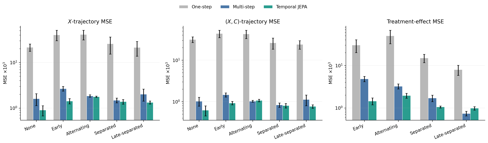

# Learning Causally Relevant Temporal States in Medical World Models

This repository contains the focused proof of concept developed for the Cambridge
research task *A foundation model that truly understands time*.

## Central claim

Accurate prediction of observed patient trajectories does not by itself certify
accurate long-horizon treatment-effect simulation. In a controlled longitudinal
medical system, finite latent states can omit treatment-relevant history; even when
that information is recoverable from the encoded state, recursive transitions may
fail to preserve it. We therefore test an action-conditioned **Temporal JEPA** that
self-supervises multi-horizon latent dynamics from factual trajectories. It improves
absolute trajectories and treatment-effect trajectories on most tested schedules,
while one negative schedule shows that latent closure is useful evidence rather
than a universal causal certificate.



## What is evaluated

The simulator exposes severity (X_t), a treatment-effect modifier (C_t), dose
memory, lagged treatment, and a nuisance variable. Training trajectories follow a
state-dependent historical treatment policy. All variables needed for causal
identification are observed or recoverable by construction, so the study isolates
finite-model representation and transition errors rather than hidden confounding.

The released experiments answer three questions:

1. **Representation:** does latent compression retain information needed for
   treatment-effect estimation?
2. **Propagation:** does the learned transition preserve treatment-relevant
   information during recursive rollout?
3. **Improvement:** does multi-horizon latent self-supervision improve 16-step
   trajectories under fixed treatment schedules?

The final test reports:

- absolute (X)-trajectory MSE;
- joint ((X,C))-trajectory MSE;
- treatment-effect trajectory MSE, comparing each intervention schedule with no
  future treatment.

Counterfactual simulator outcomes are used only for final evaluation, never for
training or hyperparameter selection.

## Repository layout

```text
src/temporal_dte/
  medical_latent.py             simulator, Transformer encoder, probes
  functional_use_experiment.py  factual data generator used by diagnostics
  latent_test_validation.py     model bank for transition diagnosis
  transition_diagnosis.py       encoded-state vs rolled-state audit
  compositional_latent.py       rollout and schedule utilities
  temporal_jepa.py              baselines and Temporal JEPA
  temporal_jepa_ablation.py     horizon, EMA, and selection sensitivity

scripts/                        one entry point per reported experiment
results/                        aggregated CSV/JSON results
figures/                        paper figures
docs/                           report sections and experimental appendix
tests/                          simulator and Temporal JEPA tests
```

Exploratory experiments that are not used by the final report have been removed.
Model checkpoints are intentionally excluded from Git because the scripts recreate
them deterministically.

## Installation

Python 3.10 or newer is required.

```bash
git clone https://github.com/zilongwang0212/cambridge-research-task.git
cd cambridge-research-task
python3 -m venv .venv
source .venv/bin/activate
make install
make test
```

PyTorch runs on CPU; a GPU shortens training but is not required.

## Reproduce the paper results

Run the complete pipeline:

```bash
make reproduce
```

The dependency order matters. `latent-test` creates the checkpoints consumed by
`transition-diagnosis`, and `temporal-jepa` creates those consumed by
`trajectories`. The Makefile handles this automatically.

To reproduce only one part:

```bash
make medical-latent            # latent-capacity study and probes
make transition-diagnosis      # trains/loads the 45-model bank, then audits rollout
make temporal-jepa             # one-step, multi-step, and JEPA models
make trajectories              # H=16 trajectory and effect evaluation
make temporal-jepa-ablation    # latent horizons, EMA, and selection sensitivity
```

Each neural result aggregates five seeds. Generated checkpoints (`*.pt`) are local
artifacts under `results/` and are ignored by Git. Aggregated tables and figures are
written back to the corresponding `results/` and `figures/` subdirectories.

## Main findings

- At latent dimension 1, severity remains recoverable ((R^2=0.927)) while the
  treatment-effect modifier is largely lost ((R^2=0.073)); factual error changes
  little, but horizon-16 effect error is 2.55 times that of dimension 2.
- Across 45 fitted models, the median horizon-16 rolled-to-encoded local-response
  error amplification is 4.82 under alternating treatment.
- Relative to multi-step prediction, Temporal JEPA reduces mean horizon-16
  (X)-trajectory MSE by 29.2% and mean treatment-effect trajectory MSE by 48.3%.
  It improves three of four treatment-effect schedules; late-separated treatment is
  the reported negative result.

These results support a narrow behavioral capability—reliable composition of
treatment-conditioned temporal dynamics—not a claim of general human-like temporal
understanding or causal identification from arbitrary observational data.

## Report files

- [`docs/section6_experiments.tex`](docs/section6_experiments.tex): empirical section
- [`docs/appendix_b_experimental_details.tex`](docs/appendix_b_experimental_details.tex):
  simulator, architecture, schedules, selection, and ablations
- [`docs/sections_2_3.tex`](docs/sections_2_3.tex): formal setup
- [`docs/section3_theory_revised.tex`](docs/section3_theory_revised.tex): theory draft

## License

MIT
